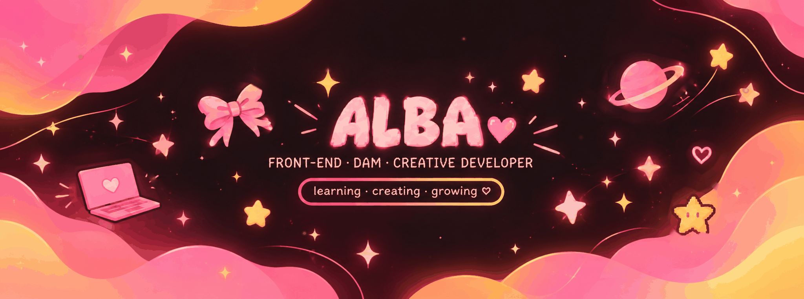

  
   
  

<h2></h2>

¡Hola! Soy **Alba** y actualmente estudio **Desarrollo de Aplicaciones Multiplataforma (DAM)**.

Estoy descubriendo poco a poco todo lo que ofrece el mundo del desarrollo y, entre todas sus áreas, hay una que me llama especialmente la atención: **el Front-End**.

Me encanta la parte en la que una idea empieza a tomar forma y se convierte en algo que puedes **ver, utilizar y disfrutar**. Me interesa especialmente crear interfaces que no solo funcionen correctamente, sino que también tengan una buena estética, sean intuitivas y hagan que la experiencia del usuario sea agradable.

Me gusta experimentar con **colores, diseños, distribución de elementos e interfaces**.

También me interesa aprender más sobre **UI/UX** y entender cómo pequeños detalles pueden cambiar completamente la experiencia al utilizar una aplicación.

Aunque todavía estoy aprendiendo, quiero aprovechar cada proyecto para probar cosas nuevas, equivocarme, mejorar y descubrir poco a poco qué tipo de desarrolladora quiero llegar a ser.

<h2></h2>

| Desarrollo | Diseño | Herramientas |
|:---:|:---:|:---:|
| **Java** | UI / UX | Git |
| **Dart** | Interfaces | GitHub |
| **Flutter** | Diseño visual | Android Studio |
| **HTML & CSS** | Experiencia de usuario | VS Code |

<h2></h2>

### ¿Por qué me interesa?

Porque es la parte del desarrollo en la que **la programación y la creatividad se encuentran**.

Me gusta pensar en cómo organizar una pantalla, qué colores utilizar, dónde colocar cada elemento y cómo conseguir que una persona pueda utilizar una aplicación de forma sencilla sin tener que pensar demasiado.

Mi objetivo es aprender a crear interfaces que sean:

**Bonitas · Intuitivas · Funcionales · Responsivas**

<h2></h2>

**Aprendiendo** nuevas tecnologías y mejorando mis conocimientos de programación.

**Experimentando** con diseño de interfaces y diferentes estilos visuales.

**Creando** pequeños proyectos para practicar lo aprendido.

**Estudiando** DAM y descubriendo qué áreas del desarrollo me gustan más.

**Construyendo** poco a poco mi propio camino dentro del mundo de la programación.

<h2></h2>

> *Este apartado irá creciendo conmigo.*

**Proyectos próximamente...**

A medida que avance en DAM iré subiendo aquí mis prácticas, proyectos personales y pequeños experimentos.

<h2></h2>

No quiero limitarme a aprender a hacer que algo **funcione**.

Quiero aprender a hacer que algo **funcione bien, se vea bien y sea agradable de utilizar**.

Mi objetivo es seguir desarrollándome como programadora, descubrir nuevas tecnologías y encontrar poco a poco mi propio estilo dentro del **Front-End**.

---

### Alba Barrasa Rodríguez

